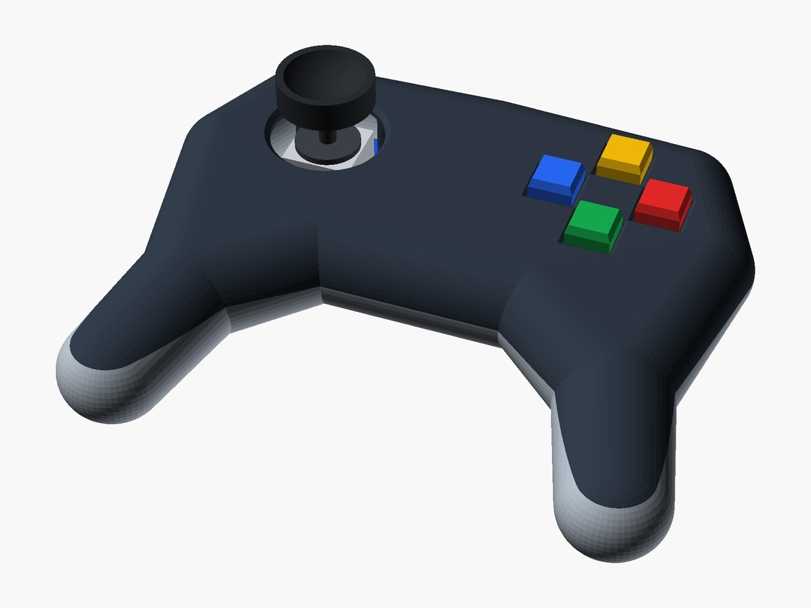
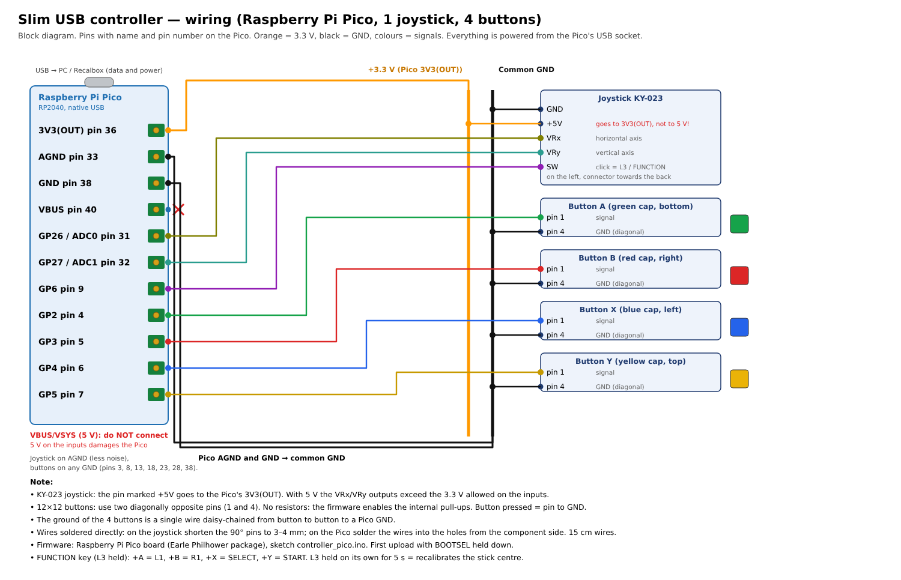

# USB controller for Recalbox and PC with Raspberry Pico, joystick and 3D-printed shell

> 📖 **Full article with step-by-step explanations (in Italian):**  
> **[USB controller for Recalbox and PC with Raspberry Pico, joystick and 3D-printed shell - www.emgi.it](https://www.emgi.it/2026/10/20/controller-usb-raspberry-pico-recalbox-stampato-3d/)**
>
> More electronics, Arduino, ESP32, Home Assistant and 3D printing projects at **[www.emgi.it](https://www.emgi.it)**

A slim **USB gamepad** with a **KY-023** analogue joystick, four buttons and the long grips of 90s gamepads, in a 3D-printed shell. Inside there is a **Raspberry Pi Pico (RP2040)**: thanks to its built-in USB it shows up as a standard controller and works **without drivers** on Windows, Linux and Mac PCs, Recalbox, RetroPie, Batocera and Android.

## What it does

- standard **USB HID gamepad**, recognised without drivers
- **analogue joystick** with dead zone and automatic centre calibration at power-on
- **digital d-pad** (hat) derived from the stick, for retro games (can be disabled)
- **four buttons** A, B, X, Y with coloured caps
- **FUNCTION key**: holding the joystick click turns the buttons into L1, R1, Select and Start (Recalbox hotkey)
- **recalibration** by holding the joystick click on its own for 5 seconds
- **slim shell**: 23 mm in the middle, 134 × 111 mm, two halves closed with six M3 screws

## Parts used

- **Raspberry Pi Pico** (RP2040), original with micro-USB or a same-size clone with **USB-C** (21 × 51 mm)
- **KY-023** joystick module
- 4 **12×12×7.3** tactile buttons with 10×10 square caps (green, red, blue, yellow)
- USB **data** cable (not charge-only)
- screws: 4 × M3×12 and 2 × M3×8 cheese head (closing, the M3×8 in the grips), 5 × M3×6 button head (joystick and plate)
- about 90 g of **PLA or PETG**, 0.14–0.25 mm² flexible wire, heat-shrink tubing

Approximate cost **€10-15**.

## Wiring

Full diagram: [`docs/wiring_diagram.png`](docs/wiring_diagram.png) (also as [SVG](docs/wiring_diagram.svg)).

| Component | Pin | Raspberry Pi Pico |
|---|---|---|
| KY-023 joystick | VRx | GP26 / ADC0 (pin 31) |
| KY-023 joystick | VRy | GP27 / ADC1 (pin 32) |
| KY-023 joystick | SW (click = L3 / FUNCTION) | GP6 (pin 9) |
| KY-023 joystick | +5V | **3V3(OUT) (pin 36)** |
| KY-023 joystick | GND | AGND (pin 33) |
| Button A (bottom, green) | pin 1 | GP2 (pin 4) |
| Button B (right, red) | pin 1 | GP3 (pin 5) |
| Button X (left, blue) | pin 1 | GP4 (pin 6) |
| Button Y (top, yellow) | pin 1 | GP5 (pin 7) |
| 4 buttons | pin 4 | GND (pin 38 or another GND), one wire daisy-chained from button to button |

Notes:
- **Power**: everything is powered from the Pico's USB socket. The joystick pin marked **+5V goes to 3V3(OUT)**, not to VBUS or VSYS: the Pico inputs handle 3.3 V.
- **Grounds**: the joystick goes to the analogue ground **AGND** (more stable axes), the buttons to any GND (pins 3, 8, 13, 18, 23, 28, 38). All Pico grounds are common.
- **Buttons**: no resistors, the firmware enables the internal pull-ups (`INPUT_PULLUP`); pressed = pin to GND. Use two **diagonally opposite** pins (1 and 4): the ones on the same side are already connected together.
- The wires are soldered directly: Dupont connectors do not fit in the shell.

## Repository contents

| Path | Content |
|---|---|
| `firmware/controller_pico/` | Arduino IDE sketch (Raspberry Pi Pico/RP2040 package by Earle F. Philhower) |
| `stl/` | The three parts to print: top shell (already upside down), bottom shell, button plate |
| `openscad/` | Parametric OpenSCAD source of the shell |
| `docs/assembly_guide.html` | 7-step assembly guide with bill of materials, 3D drawings and wiring table (opens in the browser) |
| `docs/wiring_diagram.*` | Wiring block diagram |
| `images/` | Images |

## How to use it

1. Print the three parts in PLA or PETG (0.2 mm layers, 3 perimeters, 20%, tree supports from the bed only under the grips). First measure your joystick and Pico and, if needed, correct `joy_fori`, `joy_alt`, `pm_sp` and `usb_h` in [`openscad/controller_pico.scad`](openscad/controller_pico.scad).
2. In the Arduino IDE install the **Raspberry Pi Pico/RP2040/RP2350** package by Earle F. Philhower (URL: `https://github.com/earlephilhower/arduino-pico/releases/download/global/package_rp2040_index.json`). No libraries to add.
3. Open [`firmware/controller_pico/controller_pico.ino`](firmware/controller_pico/controller_pico.ino), board **Raspberry Pi Pico**. The first upload is done holding **BOOTSEL** while plugging in the cable (port `UF2_Board`); later uploads start by themselves.
4. Assemble and wire it following the [assembly guide](docs/assembly_guide.html) (download it and open it in the browser) and the table above.
5. Plug in the cable without touching the stick (centre calibration) and test it with `joy.cpl` on Windows or from the Recalbox controller configuration.

| Combination | Function |
|---|---|
| L3 + Y | Start |
| L3 + X | Select (Recalbox hotkey) |
| L3 + A | L1 |
| L3 + B | R1 |
| L3 pressed and released | L3 click |
| L3 held on its own for 5 s | recalibrates the stick centre |

If an axis is reversed, change `INVERT_X`, `INVERT_Y` or `SWAP_XY` at the top of the sketch. Sending `d` from the serial monitor shows the raw stick values.

Details, design choices and troubleshooting: **[article on www.emgi.it](https://www.emgi.it/2026/10/20/controller-usb-raspberry-pico-recalbox-stampato-3d/)** (in Italian).

## Credits

- [arduino-pico](https://github.com/earlephilhower/arduino-pico) by Earle F. Philhower - Arduino core for the RP2040 with USB joystick support

## License

- Code: [MIT](LICENSE)
- 3D models, diagram, guide and images: [CC BY-SA 4.0](https://creativecommons.org/licenses/by-sa/4.0/)

---

**Author:** Massimiliano Sandrin - **[eMGi.it](https://www.emgi.it)** · Questions and comments below the [article on the website](https://www.emgi.it/2026/10/20/controller-usb-raspberry-pico-recalbox-stampato-3d/).
